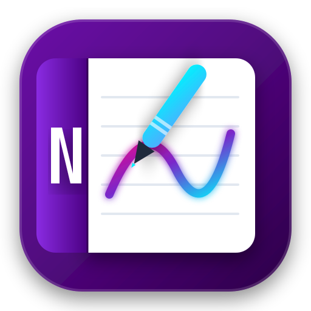
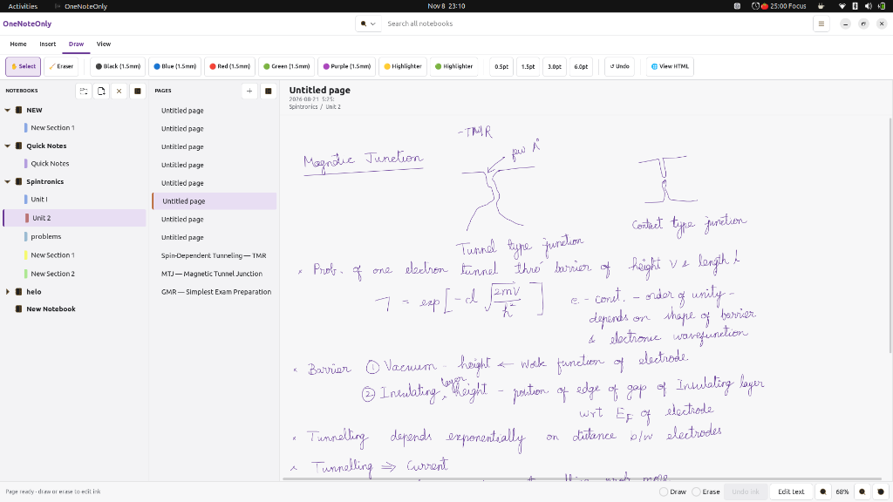
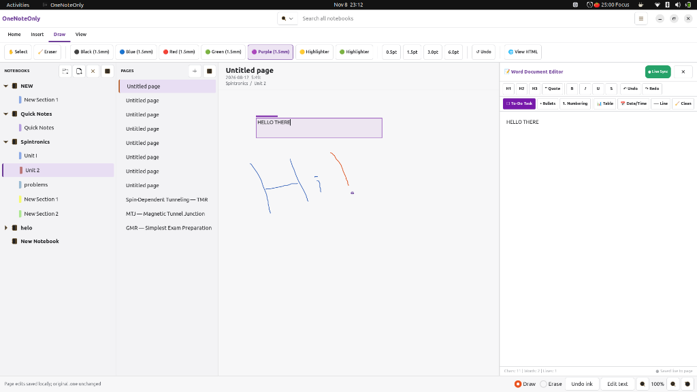
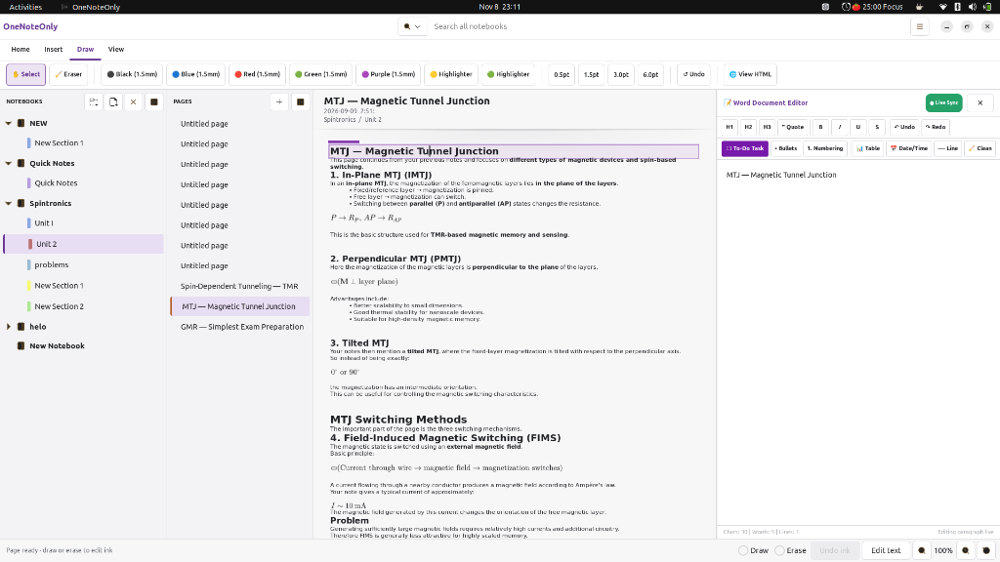

# OneNoteOnly — Native Linux OneNote Workstation and Sketch Editor

<p align="center">
  
</p>

<p align="center">
  <b>The Modern, Feature-Complete Microsoft OneNote Workstation for Linux.</b><br/>
  <i>In-Canvas Vector Inks and Sketches • Live Word-like Rich Text Editing • Arbitrary Canvas Notes and Images • Interactive SVG/HTML Exporter</i>
</p>

<p align="center">
  <a href="LICENSE"></a>
  <a href="https://www.gtk.org/"></a>
  <a href="https://www.rust-lang.org/"></a>
  <a href="https://github.com/ROHANSHAJ/OneNoteOnly"></a>
  <a href="https://github.com/emsi/OneNoteViewer"></a>
</p>

---

## Screenshots

### 1. Vector Ink and Handwriting Visibility
High-precision Cairo vector rendering displaying complex handwritten notes, formulas, and technical diagrams with zero fragmentation and accurate stroke scaling.

<p align="center">
  
</p>

### 2. In-Canvas Live Typing and Freehand Sketching
Single-click floating cursor placement anywhere on the canvas, direct in-place note typing, and real-time color ink sketching with pressure sensitivity.

<p align="center">
  
</p>

### 3. Synchronized Live Word Document Editor Dock
Slide-out Word-style editor with live bidirectional canvas synchronization, headings, typography, To-Do checkbox lists, and table formatting.

<p align="center">
  
</p>

---

## Acknowledgement and Upstream Credits

OneNoteOnly is built upon the pioneering foundation of **[OneNoteViewer](https://github.com/emsi/OneNoteViewer)** created by **Mariusz Woloszyn** (`@emsi`) and the **`onenote.rs` parser** by **Markus Siemens**, distributed under the **GPL-3.0-or-later** license.

We extend our deepest gratitude to Mariusz Woloszyn and the open-source contributors of OneNoteViewer for reverse engineering the binary Microsoft OneNote file structures (`.one`, `.onetoc2`, `.onepkg`). OneNoteOnly extends this foundation into a full-fledged Linux creative and document editing workstation.

---

## Key Features

```text
+---------------------------------------------------------------------------------------+
|                                    ONENOTEONLY                                        |
+---------------------------------------------------------------------------------------+
|  [Ribbon Toolbar: File | Home | Insert | Draw | View]                 [Quick Access]  |
+---------------------------------------------------------------------------------------+
|   NOTEBOOK TREE   |               INFINITE FREEFORM CANVAS             |  LIVE WORD   |
|                   |                                                    |    EDITOR    |
|   My Notebook     |  [Original Note Content and Math Equations]        |              |
|     General       |                                                    | H1 H2 H3 B I |
|     Sketches      |  [Batched Cairo Vector Inks / Highlighting]        |              |
|     Tasks         |  • Zero fragmentation, smooth pen strokes          | Live typing  |
|                   |                                                    | syncs to the |
|                   |  [Added Text Boxes Anywhere on Canvas]             | selected     |
|                   |  • Single-click anywhere to type!                  | paragraph or |
|                   |                                                    | note box!    |
|                   |  [Inserted Images and Diagrams]                    |              |
|                   |                                                    | [x] Done!    |
|                   |  [Direct-Click Task Checkbox Toggling]             | Chars: 420   |
|                   |  • Instant click to toggle without popups          | Words: 84    |
+---------------------------------------------------------------------------------------+
```

### 1. In-Canvas Vector Ink and Sketch Engine
- **Full Drawing and Ink Visibility**: Resolves missing, unscaled, or invisible ink strokes from OneNote desktop and tablet notebooks.
- **Hardware-Accelerated Cairo Batched Drawing**: Strokes are dynamically batched into single Cairo render passes, eliminating GTK4 scene-graph node explosion and guaranteeing smooth 60 FPS drawing.
- **Comprehensive Drawing Tools**: Freehand pens (Black, Blue, Red, Green, Purple), semi-transparent fluorescent highlighters (Yellow, Green), precision stroke eraser, and adjustable stroke widths (0.5pt to 6.0pt).
- **Persistent Ink Storage**: Local non-destructive ink edit manifests preserve your custom drawings across application restarts.

### 2. In-Canvas Floating Cursor and Live Note Creation
- **Click-Anywhere Text Placement**: Single-click anywhere on the infinite canvas to position a floating cursor and begin typing immediately.
- **Accurate Pango Caret and Blinking Timer**: Interactive 530ms blinking cursor aligned with character clusters and font metrics.
- **Insert Local Images Anywhere**: Place PNG, JPEG, SVG, WebP, BMP, or GIF images anywhere on the canvas via the Ribbon or file picker.

### 3. Create New Notebooks and Sections (.one Sub-Files)
- **Authentic OneNote Binary Templates**: Embedded binary templates for `Open Notebook.onetoc2` and `.one` section files ensure genuine file format compatibility.
- **Interactive Notebook Creation Dialog** (`Ctrl+Shift+N`): Initialize complete notebook folder hierarchies with custom storage paths.
- **Interactive Section Creation Dialog** (`Ctrl+Alt+N` / `Ctrl+Shift+S`): Add new `.one` section sub-files to any active notebook.
- **Quick-Access Navigation Band Buttons**: Dedicated header buttons in the `NOTEBOOKS` navigation band for one-click notebook and section creation.

### 4. Live Word Document Editor Dock
- **Slide-Out Document Sidebar**: Click any paragraph or note box to open the full-featured Word-style rich text editor.
- **Live Typing Synchronization**: Text updates live on the canvas as you type.
- **Formatting Tools**:
  - Headings: **H1** (24pt), **H2** (18pt), **H3** (15pt), Blockquote.
  - Typography: **Bold** (`Ctrl+B`), *Italic* (`Ctrl+I`), <u>Underline</u> (`Ctrl+U`), ~~Strikethrough~~.
  - Productivity: To-Do Task Checkboxes (`Ctrl+1`), Bulleted Lists, Numbered Lists, 3×3 Tables, Timestamp Inserts, and Dividers.
  - Visual Syntax Highlighting: GTK `TextTag` engine renders bold and headings directly in the editor buffer.

### 5. In-Canvas Task Checkbox Toggling
- Clicking directly on any task checkbox (`☐` / `☑` or `[ ]` / `[x]`) on the canvas toggles the task immediately without modal popups.

### 6. Standalone CLI Exporter (onenote-export)
- Includes the `onenote-export` command-line utility.
- Batch-converts `.one` notebooks into interactive standalone SVG sheets or self-contained HTML viewers that open in any modern web browser.

---

## Installation for Linux

### Method 1: Automated Installer (Recommended)

Run the universal installer script:

```bash
git clone https://github.com/ROHANSHAJ/OneNoteOnly.git
cd OneNoteOnly
./install.sh
```

This installs:
- Main executable to `~/.local/bin/onenoteonly` (and `~/.local/bin/onenote-viewer` symlink)
- CLI Exporter to `~/.local/bin/onenote-export`
- Vector application logo to `~/.local/share/icons/hicolor/scalable/apps/onenoteonly.svg`
- Desktop shortcut to `~/.local/share/applications/OneNoteOnly.desktop` with MIME associations

### Method 2: Build from Source

**Dependencies**:
- Rust 1.85+ (`curl --proto '=https' --tlsv1.2 -sSf https://sh.rustup.rs | sh`)
- GTK4, Cairo, Pango, and SQLite development headers:
  ```bash
  # Ubuntu / Debian / Pop!_OS
  sudo apt install libgtk-4-dev libcairo2-dev libpango1.0-dev libsqlite3-dev build-essential pkg-config

  # Fedora
  sudo dnf install gtk4-devel cairo-devel pango-devel sqlite-devel gcc

  # Arch Linux / Manjaro
  sudo pacman -S gtk4 cairo pango sqlite base-devel
  ```

**Build and Run**:
```bash
cargo build --release -p onenote-viewer
./target/release/onenote-viewer
```

---

## Keyboard Shortcuts

| Shortcut | Action |
| :--- | :--- |
| `Ctrl + Shift + N` | Create New OneNote Notebook |
| `Ctrl + Alt + N` / `Ctrl + Shift + S` | Create New Section (`.one` sub-file) |
| `Ctrl + N` | Create New Page |
| `Ctrl + O` | Open local `.one` file or notebook folder |
| `Ctrl + Shift + O` | Open notebook directory |
| `Ctrl + Shift + I` | Import OneNote Package (`.onepkg`) |
| `Ctrl + F` | Find in current page |
| `F3` / `Shift + F3` | Find next / previous match in page |
| `Ctrl + E` | Focus global workspace search |
| `Ctrl + B` | Toggle **Bold** text |
| `Ctrl + I` | Toggle *Italic* text |
| `Ctrl + U` | Toggle <u>Underline</u> text |
| `Ctrl + 1` | Toggle task checkbox (`☐` <-> `☑`) |
| `Ctrl + Z` / `Ctrl + Y` | Undo / Redo in Word Editor |
| `Ctrl + +` / `Ctrl + -` | Zoom In / Zoom Out page canvas |
| `Ctrl + 0` | Reset zoom to 100% |
| `Single Click` | Place floating cursor and type notes anywhere |

---

## Repository Structure

```text
OneNoteOnly/
├── crates/
│   ├── onenote-core/           # Document object models, styles, ink strokes and primitives
│   ├── onenote-index/          # Full-text SQLite notebook search and indexing
│   ├── onenote-render/         # Freeform page layout resolution, math and layout culling
│   ├── onenote-render-gtk/     # GTK4 canvas, batched Cairo ink engine and arbitrary placement
│   └── onenote-viewer/         # Desktop application, ribbon UI, and Live Word Editor
├── docs/
│   └── images/                 # High-resolution screenshots and visual assets
├── packaging/
│   ├── OneNoteOnly.desktop     # Freedesktop application entry
│   └── flatpak/                # Flatpak manifest definition
├── install.sh                  # Universal Linux installer script
├── Cargo.toml                  # Cargo workspace specification
├── LICENSE                     # GNU General Public License v3.0
└── README.md                   # Technical documentation and user guide
```

---

## License and Attribution

This project is licensed under the **GNU General Public License v3.0 or later** ([GPL-3.0-or-later](LICENSE)).

- **Original Project**: [OneNoteViewer](https://github.com/emsi/OneNoteViewer) by **Mariusz Woloszyn**
- **OneNote Parser**: [onenote.rs](https://github.com/emsi/onenote.rs) by **Markus Siemens**
- **Linux Enhancements, Inks and Word Workstation**: **Rohan Shaj** (`@ROHANSHAJ`)
